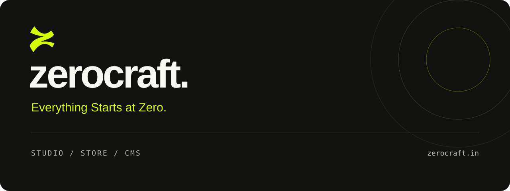

<p align="center">
  
</p>

<p align="center">
  <a href="https://zerocraft.in"><strong>Studio</strong></a> ·
  <a href="https://store.zerocraft.in"><strong>Store</strong></a> ·
  <a href="https://admin.zerocraft.in"><strong>Admin</strong></a> ·
  <a href="#getting-started"><strong>Getting started</strong></a>
</p>

# Zerocraft

**Everything Starts at Zero.**

The digital home of **Zerocraft Studio**: a creative studio, a store for posters, merchandise and custom products, and a shared workspace for managing the business.

Zerocraft brings together branding, design, web and app development, photography, video and motion. This repository contains the applications and shared infrastructure behind that experience.

## One brand. Three connected experiences.

| Application | Purpose | Website | Local development |
| --- | --- | --- | --- |
| **Studio** | Creative services, work and the Zerocraft brand | [zerocraft.in](https://zerocraft.in) | [localhost:3000](http://localhost:3000) |
| **Store** | Product discovery, catalog, cart and checkout | [store.zerocraft.in](https://store.zerocraft.in) | [localhost:3001](http://localhost:3001) |
| **CMS** | Internal content and commerce administration | [admin.zerocraft.in](https://admin.zerocraft.in) | [localhost:3002](http://localhost:3002) |

The CMS is an authenticated internal application. Feature availability depends on environment configuration, integrations and applied database migrations; source code alone does not establish deployment readiness.

## Built with

| Layer | Technology |
| --- | --- |
| Applications | Next.js 16 · React 19 · TypeScript |
| Styling and interaction | Tailwind CSS 4 · GSAP · Framer Motion |
| Data and authentication | Supabase |
| Workspace | npm workspaces · Turborepo |
| Quality | ESLint · TypeScript · Playwright · CMS quality gate |
| Deployment | Vercel |

## Repository map

| Path | Contents |
| --- | --- |
| [`apps/studio`](./apps/studio) | Public creative studio website |
| [`apps/store`](./apps/store) | Zerocraft Store |
| [`apps/cms`](./apps/cms) | Internal administration application |
| [`packages/supabase`](./packages/supabase) | Shared data utilities, SQL and migrations |
| [`packages/tailwind-config`](./packages/tailwind-config) | Shared styling configuration |
| [`scripts`](./scripts) | Verification, release and maintenance tools |
| [`tests`](./tests) | Browser tests |
| [`docs`](./docs) | Architecture, audits and operational guidance |

## Getting started

Use **Node.js 22** (the version used by CI) and **npm 11.17.0** (declared in `package.json`). Run workspace commands from the repository root.

```bash
git clone https://github.com/zerocraft-in/zerocraft.git
cd zerocraft
npm ci
```

### Configure the applications

Copy each application's `.env.example` to `.env.local` in the same folder.

**Windows PowerShell**

```powershell
Copy-Item apps/studio/.env.example apps/studio/.env.local
Copy-Item apps/store/.env.example apps/store/.env.local
Copy-Item apps/cms/.env.example apps/cms/.env.local
```

**macOS / Linux**

```bash
cp apps/studio/.env.example apps/studio/.env.local
cp apps/store/.env.example apps/store/.env.local
cp apps/cms/.env.example apps/cms/.env.local
```

Fill in the required values for your approved development environment. The root [`.env.example`](./.env.example) is an additional reference for integrations and hostname routing; copying it does not automatically configure every Next.js app.

Keep service-role keys, OAuth secrets, SMTP credentials and encryption keys server-side. Do not commit `.env.local` files. Checkout and manual-payment flags should remain disabled until their required migrations and staging checks have been reviewed.

### Start development

```bash
npm run dev
```

Or start one application:

```bash
npm run dev:studio
npm run dev:store
npm run dev:cms
```

## Checks and builds

| Command | Purpose |
| --- | --- |
| `npm run lint` | Repository ESLint checks |
| `npm run typecheck` | Workspace type checks |
| `npm run build` | Build all applications |
| `npm run build:studio` | Build Studio |
| `npm run build:store` | Build Store |
| `npm run build:cms` | Build CMS |
| `npm run test:security` | RBAC and Gmail workspace checks |
| `npm run verify:release` | CMS release verification |
| `npm run test:store:responsive` | Store responsive browser tests |

Some checks require environment variables, configured services or browser prerequisites. See the relevant script and release documentation before running database verification, seed or maintenance commands.

## Documentation

- [CMS documentation index](./docs/cms/README.md)
- [CMS architecture](./docs/cms/CMS_APP_ROUTER_ARCHITECTURE.md)
- [Operations runbook](./docs/cms/OPERATIONS_RUNBOOK.md)
- [Release checklist](./docs/cms/RELEASE_CHECKLIST.md)
- [Post-release monitoring](./docs/cms/POST_RELEASE_MONITORING.md)
- [Store responsive release checklist](./docs/store-responsive-release-checklist.md)
- [Contribution guide](./CONTRIBUTING.md)
- [Brand and repository presentation](./docs/BRAND.md)

Audit reports describe the state observed on their recorded dates. Consult current code and release checks when assessing the present state.

## Working on Zerocraft

Read the nearest `AGENTS.md` before changing an application. Keep changes focused, use the existing brand assets and UI conventions, and include relevant validation with each pull request. Database changes and production releases require separate operational review.

## Ownership

Maintained by **Zerocraft Studio**.

This is a private business repository. No open-source license is granted by this repository. Zerocraft names, logos, artwork and client materials remain subject to their respective owners' rights.

---

**Zerocraft Studio** · [zerocraft.in](https://zerocraft.in)  
Branding · Design · Development · Photography · Video · Motion
